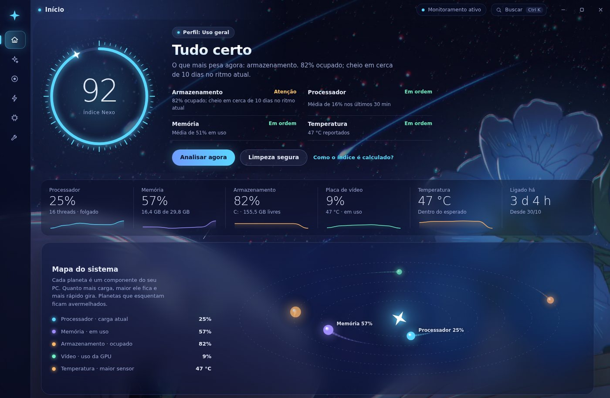
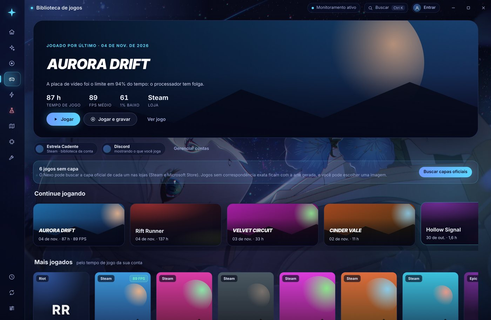
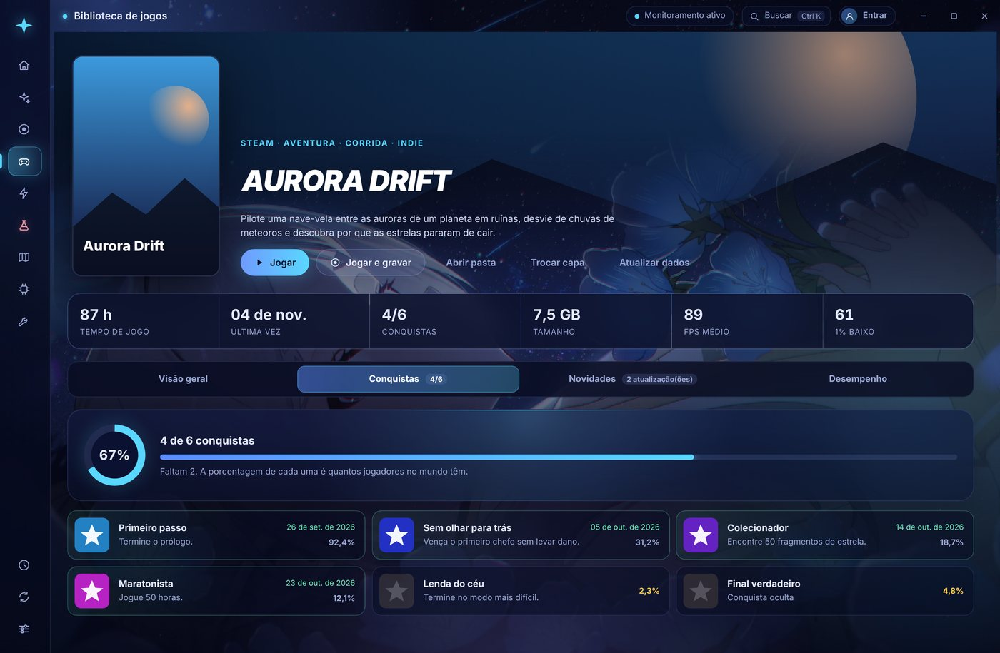
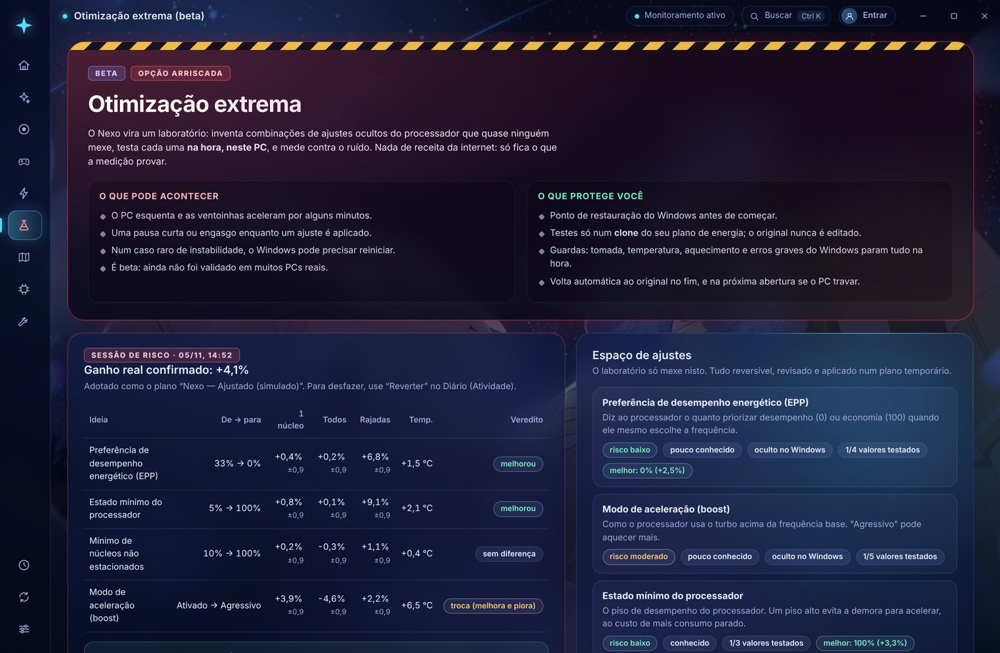
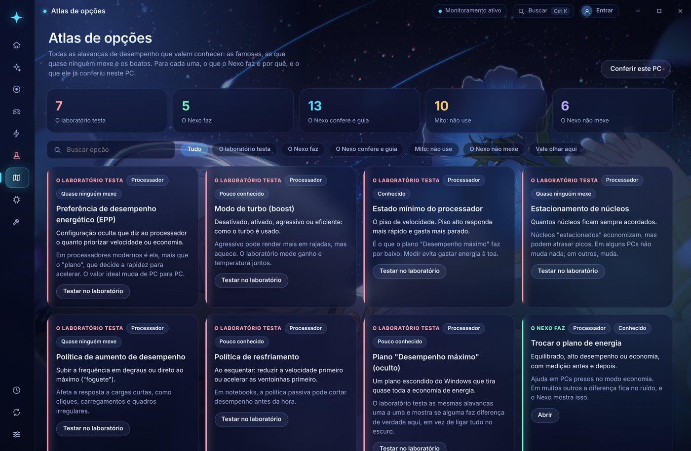
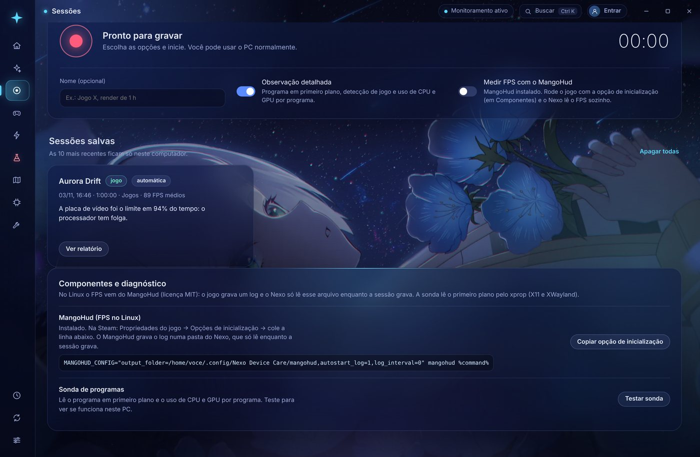

  

  <a href="README.md">Português</a> · <b>English</b>

  
  
  
  

<h3 align="center">Care for your PC under the stars.</h3>

  Nexo measures your computer, explains what is slowing it down and only changes 
  something after you confirm. Everything stays on your PC, and almost everything can be undone.

  <b>Free</b> · <b>no required account</b> · <b>nothing changes without your OK</b> · <b>no “+50 FPS” promises</b>

  <a href="https://github.com/Samuklvm/Project-Nexo/releases/latest"><b>⬇️ Download the latest version</b></a>

  

Screenshots show the app in Portuguese.

---

## ✨ Why Nexo is different

| | |
|---|---|
| 📏 **Measures before it touches** | Every tweak can be measured before and after. If there is no real gain, Nexo tells you. |
| ↩️ **Reversible** | Every change goes into a Journal with the previous value and, when it can be undone, a **Revert** button. What cannot be undone (like emptying the Recycle Bin) warns you first. |
| 🔒 **Stays on your PC** | No required account. The analysis runs on your computer; on the Nexo server, sync and telemetry are optional and start off, and only error reports are always sent, with nothing personal. |
| 🧭 **Honest** | No “speed up your PC by 300%”. Nexo shows the evidence and the limits of every conclusion. |
| 🌌 **Beautiful and light** | A living sky with fireflies and shooting stars, seven accent colors and more than 30 features on every screen, without weighing down your PC. |

## 🎮 Built for gamers

<table>
  <tr>
    <td width="50%"></td>
    <td width="50%"></td>
  </tr>
  <tr>
    <td><b>Complete library.</b> Every installed game (Steam, Epic, GOG, Xbox/Game Pass, EA, Ubisoft, Battle.net, Riot, Rockstar and the ones you add), with official covers.</td>
    <td><b>A page for each game.</b> Description, screenshots, requirements, <b>your achievements</b> with global rarity, official news and updates, and the FPS of every session.</td>
  </tr>
</table>

- **Observation sessions:** record your PC while you play and get a report that says whether the limit was the graphics card, a single CPU core, memory, heat or a background program. Measures **FPS, 1% low and frame time** (PresentMon on Windows, MangoHud on Linux).
- **Automatic recording:** optionally, Nexo starts recording when a game opens and saves the report when it closes.
- **Sign in with Steam:** the official Steam login (Nexo never sees the password) brings your account's games, playtime and achievements, with no key needed and even without Steam installed.
- **Discord:** shows the game being measured on your profile, with the Nexo icon.

## ⚡ Optimization backed by evidence

<table>
  <tr>
    <td width="50%"></td>
    <td width="50%"></td>
  </tr>
  <tr>
    <td><b>Extreme optimization (beta).</b> A lab that tests <b>71 hidden settings</b> (processor, cores, idle states, SSD, PCI Express and Wi-Fi) and novel combinations <b>on your PC</b>, in a temporary power plan, with a restore point first and A/B measurement against noise. It only adopts what the measurement confirmed. Includes the <b>X-ray</b> (109 registry, service and power plan settings, with apply and revert) and the <b>reboot test</b>, which measures the PC restarting without and with the settings. 702 options in total.</td>
    <td><b>Options Atlas.</b> The performance levers worth knowing, including the myths you should <b>not</b> follow and what Nexo refuses to do.</td>
  </tr>
</table>

- **Slow internet? Network diagnosis:** for when the connection is fine but sites take long to open. It compares your network's DNS with Cloudflare's and Google's, tests IPv6, the proxy, the cable and a real site, and suggests the fix (like switching DNS), with undo from the Journal.
- **Safe cleanup:** old temporary files, crash reports and the Recycle Bin, with a preview of what goes and how much space comes back.
- **Power plan, startup and maintenance:** switch power plans with a benchmark before and after, see programs that start with the system, optimize drives and check system files.
- **Deep analysis:** in at least 60 seconds, it understands the PC part by part (the chipset and what it allows, the processor generation, each memory stick's rated speed from its part number, the PCIe link of the graphics card and the SSD, the monitor's port and refresh rate), reads 30 days of events, shows what weighs behind the game (never blaming the game, the launchers or Nexo itself), runs a short load test and builds a plan for that PC.
- **Smart analysis:** compares the current moment with your routine and points to the likely cause **with the evidence**: slowdowns, the programs that get in the way most, a forecast of when your disk fills up and heat-related clock drops.

> **About the “learning”:** it is not AI. Nexo keeps averages for every hour of the week, detects sustained episodes (high CPU, memory at its limit, heat), records who was consuming resources and adjusts its confidence in each suggestion based on your feedback. Simple and verifiable.

## 🐧 Windows and Linux

<table>
  <tr>
    <td width="50%"></td>
    <td width="50%"></td>
  </tr>
</table>

The same screens on both systems. On Linux, Nexo uses `/proc` and kernel sensors, measures FPS through MangoHud, finds Steam (including Proton) and Heroic games and switches power-profiles-daemon profiles, all without root.

| | Windows | Linux |
|---|---|---|
| **Install** | Visual installer or `Nexo-Setup` | AppImage (any distribution) or `.deb` |
| **FPS** | PresentMon | MangoHud |
| **Power** | Windows power plans | power-profiles-daemon |
| **Library** | Steam, Epic, GOG, Xbox, EA, Ubisoft, Battle.net, Riot, Rockstar | Steam (native, Flatpak, Snap) and Heroic |

## 📥 Installation

1. Download from the [latest release](https://github.com/Samuklvm/Project-Nexo/releases/latest):
   - **Windows:** `Nexo-Instalador-*.exe` (visual installer) or `Nexo-Setup-*.exe`.
   - **Linux:** `Nexo-*-x86_64.AppImage` (any distribution) or `Nexo-*-amd64.deb` (Debian, Ubuntu, Mint, Pop!_OS).
2. Open it and follow the installer. Updates arrive through the app itself, and you choose when to download them.

> **“Windows protected your PC”?** Nexo does not have a code-signing certificate yet (it is expensive for a free project), so SmartScreen warns the first time. Click **More info → Run anyway**. The installer is built automatically by GitHub from this code, and each release lists the published files.

**Linux, recommended packages:** `power-profiles-daemon`, `mangohud`, `x11-utils`, `lm-sensors`. On GNOME, the tray icon needs the AppIndicator extension.

**Uninstalling** removes the program, its data, caches, shortcuts and the settings Nexo created. From the app (**Ajustes → Desinstalar o Nexo**, that is, Settings → Uninstall Nexo), it also clears the traces Windows keeps about it and shows anything it could not remove.

## 🔒 Privacy

- Nexo has a server to **sync your account between PCs, collect errors and telemetry**. Sync and telemetry are optional and **off by default**. Telemetry is one anonymous summary per day (hardware, how heavy Nexo is, daily averages, what limited the PC, screens and features used and what failed in the app), with nothing personal; please leave it on so the app can improve on other machines.
- **Error reports are always sent** (since 0.11.1) so problems get fixed: the error message and the app's last steps before it, without your user name, your folders or anything you typed. The email of the Google account signed in to Nexo goes along so the creator can tell you when it is fixed, and you can untick it in Settings (it is also removed from reports already sent).
- Sync uses your Google sign-in as the key, stores each PC encrypted and only brings data from another PC when you choose which PC and what.
- The other external connections are only the ones you use: update checks on GitHub, game covers and data from the official stores, and the accounts you connect (Google, Steam, Discord).
- Nexo **never ends processes on its own** and does not read game memory.
- On Windows, the processor temperature needs a driver: with your permission, Nexo installs **PawnIO** (signed and open source, the same one LibreHardwareMonitor uses) and a service that only reads sensors. Both are removed when you uninstall.
- Your data can be exported or deleted in **Ajustes** (Settings).

Full inventory (in Portuguese): [PRIVACIDADE.md](PRIVACIDADE.md).

## 📄 License

Nexo Device Care is **proprietary software**: all rights reserved. You may download and use the official installers on your PC. Copying, modifying, redistributing or reusing the code is not allowed without permission. Details in [LICENSE](LICENSE).

## 📚 More

- [What changed in each version](CHANGELOG.md) (0.8.1: temperature, lab, Atlas and Maintenance fixes; 0.8.0: extreme optimization with 702 options, a registry X-ray, the reboot test and real-time readings) · [Release notes](docs/releases/)
- [For developers](docs/DEVELOPMENT.md): run, test, build installers and publish versions
- [Architecture](docs/ARQUITETURA.md) · [Game connections](docs/CONEXOES.md) · [Security](SECURITY.md)

Made in Brazil · Recommendations are heuristics and do not guarantee a performance gain on every PC.

