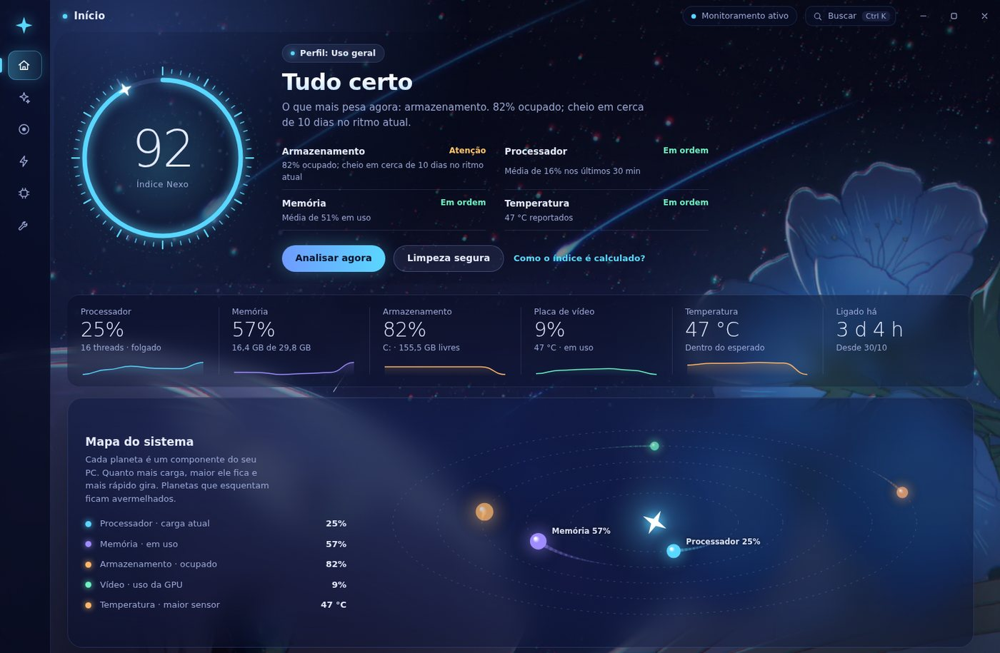
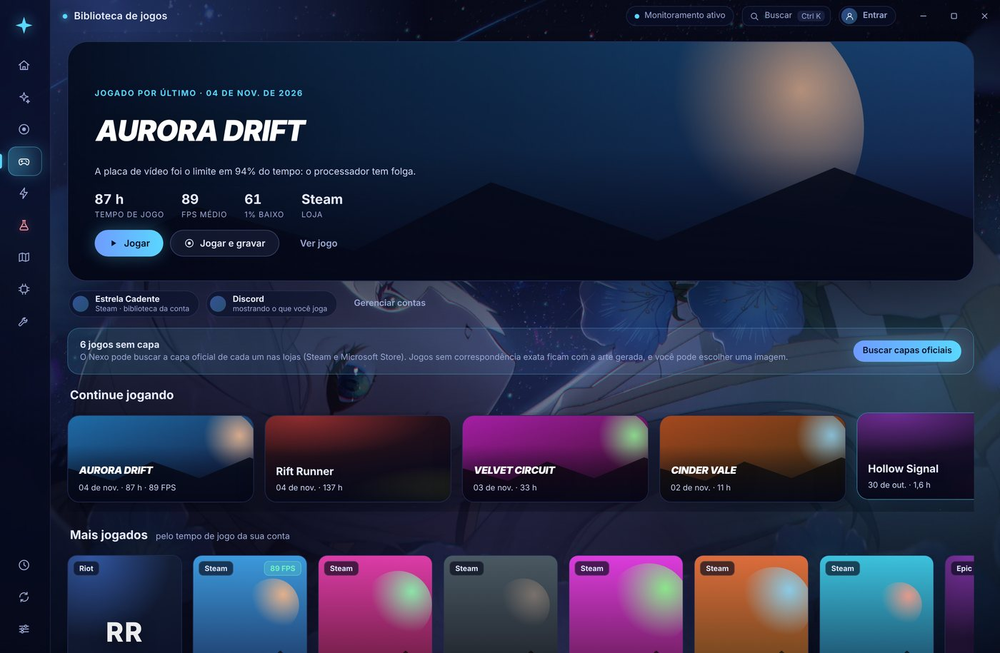
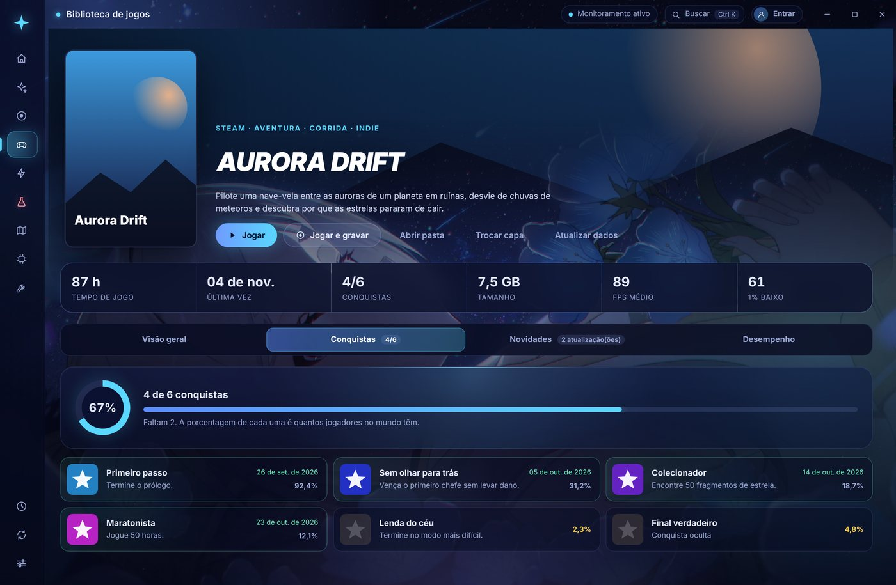
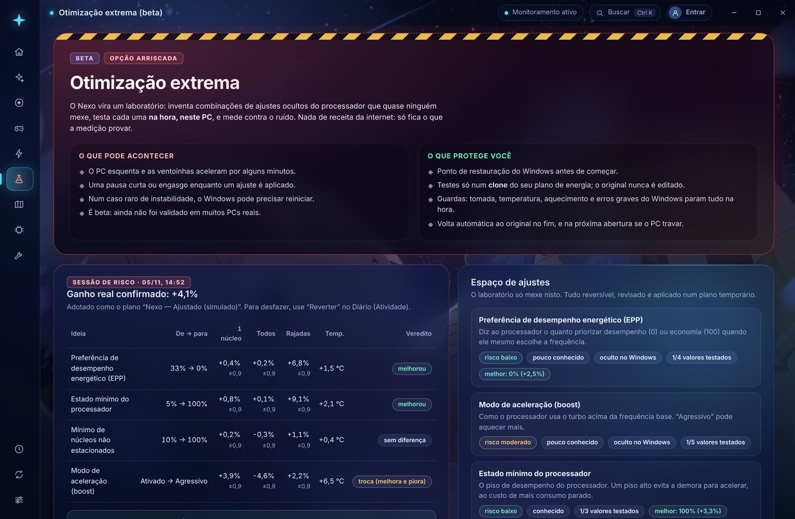
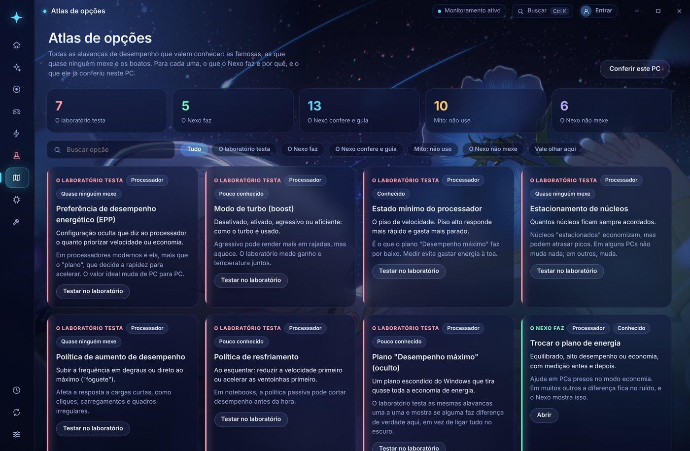
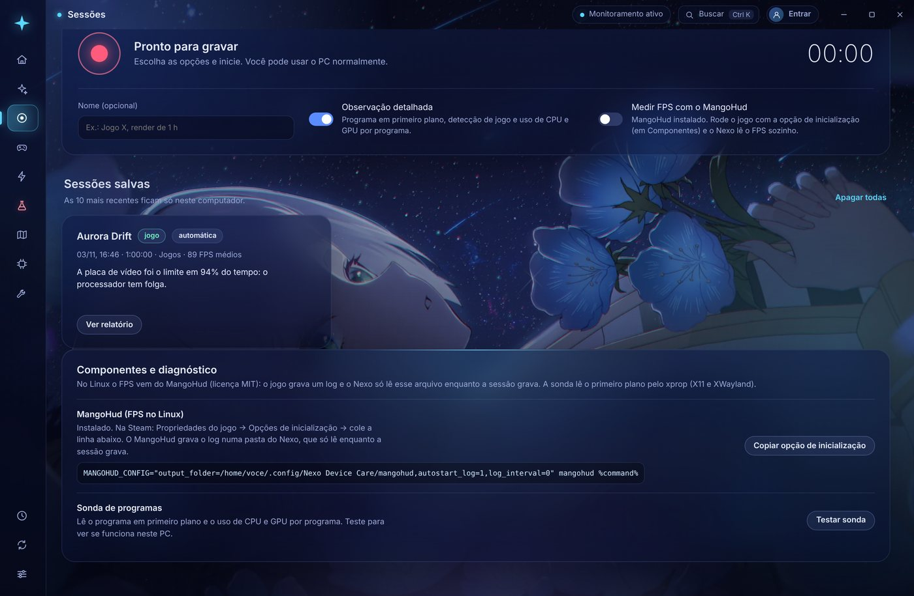

  

  <b>Português</b> · <a href="README.en.md">English</a>

  
  
  
  

<h3 align="center">Cuide do seu PC sob as estrelas.</h3>

  O Nexo mede o seu computador, explica o que está pesando e só mexe em algo 
  com a sua confirmação. Tudo fica no seu PC, e tudo pode ser desfeito.

  <a href="https://github.com/Samuklvm/Project-Nexo/releases/latest"><b>⬇️ Baixar a última versão</b></a>

  

---

## ✨ Por que o Nexo é diferente

| | |
|---|---|
| 📏 **Mede antes de mexer** | Cada ajuste pode ser medido antes e depois. Se não houver ganho real, o Nexo diz isso. |
| ↩️ **Tudo é reversível** | Cada mudança vai para um Diário, com o valor anterior e um botão **Reverter**. |
| 🔒 **Fica no seu PC** | Sem conta obrigatória e sem servidor próprio. A análise acontece no seu computador. |
| 🧭 **Honesto** | Nada de “acelere seu PC em 300%”. O Nexo mostra a evidência e os limites de cada conclusão. |

## 🎮 Feito para quem joga

<table>
  <tr>
    <td width="50%"></td>
    <td width="50%"></td>
  </tr>
  <tr>
    <td><b>Biblioteca completa.</b> Todos os jogos instalados (Steam, Epic, GOG, Xbox/Game Pass, EA, Ubisoft, Battle.net, Riot, Rockstar e os que você adicionar), com capas oficiais.</td>
    <td><b>Página de cada jogo.</b> Descrição, capturas, requisitos, <b>suas conquistas</b> com raridade global, novidades e atualizações oficiais, e o FPS de cada sessão.</td>
  </tr>
</table>

- **Sessões de observação:** grave o PC enquanto joga e receba um relatório que diz se o limite foi a placa de vídeo, um núcleo do processador, a memória, o calor ou um programa em segundo plano. Mede **FPS, 1% baixo e tempo de quadro** (PresentMon no Windows, MangoHud no Linux).
- **Gravação automática:** opcionalmente, o Nexo começa a gravar quando um jogo abre e guarda o relatório quando ele fecha.
- **Discord:** mostra no seu perfil o jogo que está sendo medido, com o ícone do Nexo.

## ⚡ Otimização com evidência

<table>
  <tr>
    <td width="50%"></td>
    <td width="50%"></td>
  </tr>
  <tr>
    <td><b>Otimização extrema (beta).</b> Um laboratório que testa <b>63 ajustes ocultos</b> (processador, núcleos, estados ociosos, SSD e PCI Express) e combinações inéditas <b>no seu PC</b>, num plano de energia temporário, com ponto de restauração antes e medição A/B contra o ruído. Só adota o que a medição confirmou. Inclui o <b>Raio-X do registro</b>, com aplicar e reverter.</td>
    <td><b>Atlas de opções.</b> As alavancas de desempenho que valem conhecer, incluindo os mitos que você <b>não</b> deve seguir e o que o Nexo se recusa a fazer.</td>
  </tr>
</table>

- **Limpeza segura:** temporários antigos, relatórios de falha e Lixeira, com prévia do que sai e quanto espaço volta.
- **Plano de energia, inicialização e manutenção:** troca do plano com benchmark antes e depois, programas que iniciam com o sistema, otimização de unidades e verificação de arquivos do sistema.
- **Análise inteligente:** compara o momento atual com a sua rotina e aponta a causa provável **com a evidência**: lentidões, programas que mais atrapalham, previsão de disco cheio e queda de clock por calor.

> **Sobre o “aprendizado”:** não é IA. O Nexo guarda médias de cada hora da semana, detecta episódios sustentados (CPU alta, memória no limite, calor), registra quem estava consumindo e ajusta a confiança de cada sugestão pelo seu feedback. Simples e verificável.

## 🐧 Windows e Linux

<table>
  <tr>
    <td width="50%"></td>
    <td width="50%"></td>
  </tr>
</table>

As mesmas telas nos dois sistemas. No Linux, o Nexo usa `/proc` e os sensores do kernel, mede FPS pelo MangoHud, encontra jogos da Steam (inclusive Proton) e do Heroic e troca perfis do power-profiles-daemon, tudo sem root.

| | Windows | Linux |
|---|---|---|
| **Instalação** | Instalador visual ou `Nexo-Setup` | AppImage (qualquer distribuição) ou `.deb` |
| **FPS** | PresentMon | MangoHud |
| **Energia** | Planos do Windows | power-profiles-daemon |
| **Biblioteca** | Steam, Epic, GOG, Xbox, EA, Ubisoft, Battle.net, Riot, Rockstar | Steam (nativa, Flatpak, Snap) e Heroic |

## 📥 Instalação

1. Baixe na [última release](https://github.com/Samuklvm/Project-Nexo/releases/latest):
   - **Windows:** `Nexo-Instalador-*.exe` (instalador visual) ou `Nexo-Setup-*.exe`.
   - **Linux:** `Nexo-*-x86_64.AppImage` (qualquer distribuição) ou `Nexo-*-amd64.deb` (Debian, Ubuntu, Mint, Pop!_OS).
2. Abra e siga o instalador. As atualizações chegam pelo próprio app, e você escolhe quando baixar.

**Linux, pacotes recomendados:** `power-profiles-daemon`, `mangohud`, `x11-utils`, `lm-sensors`. No GNOME, o ícone da bandeja precisa da extensão AppIndicator.

**Desinstalar** remove o programa, os dados, os caches, os atalhos e as configurações que o Nexo criou. Pelo app (**Ajustes → Desinstalar o Nexo**), ele também apaga os rastros que o Windows guarda sobre ele e mostra o que não conseguiu remover.

## 🔒 Privacidade

- Nada é enviado a servidores do Nexo: **não existe servidor do Nexo.**
- As conexões externas são só as que você usa: verificação de atualizações no GitHub, capas e dados de jogos das lojas oficiais e as contas que você conectar (Google, Steam, Discord).
- O Nexo **nunca encerra processos sozinho** e não lê a memória dos jogos.
- No Windows, a temperatura do processador precisa de um driver: com a sua permissão, o Nexo instala o **PawnIO** (assinado e de código aberto, o mesmo do LibreHardwareMonitor) e um serviço que só lê sensores. Tudo sai junto na desinstalação.
- Os seus dados podem ser exportados ou apagados em **Ajustes**.

Inventário completo: [PRIVACIDADE.md](PRIVACIDADE.md).

## 📄 Licença

O Nexo Device Care é **software proprietário**: todos os direitos reservados. Você pode baixar e usar os instaladores oficiais no seu PC. Copiar, modificar, redistribuir ou reutilizar o código não é permitido sem autorização. Detalhes em [LICENSE](LICENSE).

## 📚 Mais

- [Novidades de cada versão](CHANGELOG.md) (0.8.0: otimização extrema com 63 ajustes ocultos, Raio-X do registro e leituras em tempo real) · [Notas das releases](docs/releases/)
- [Para desenvolvedores](docs/DESENVOLVIMENTO.md): rodar, testar, gerar instaladores e publicar versões
- [Arquitetura](docs/ARQUITETURA.md) · [Conexões de jogos](docs/CONEXOES.md) · [Segurança](SECURITY.md)

Feito no Brasil · As recomendações são heurísticas e não garantem ganho de desempenho em todos os PCs.

